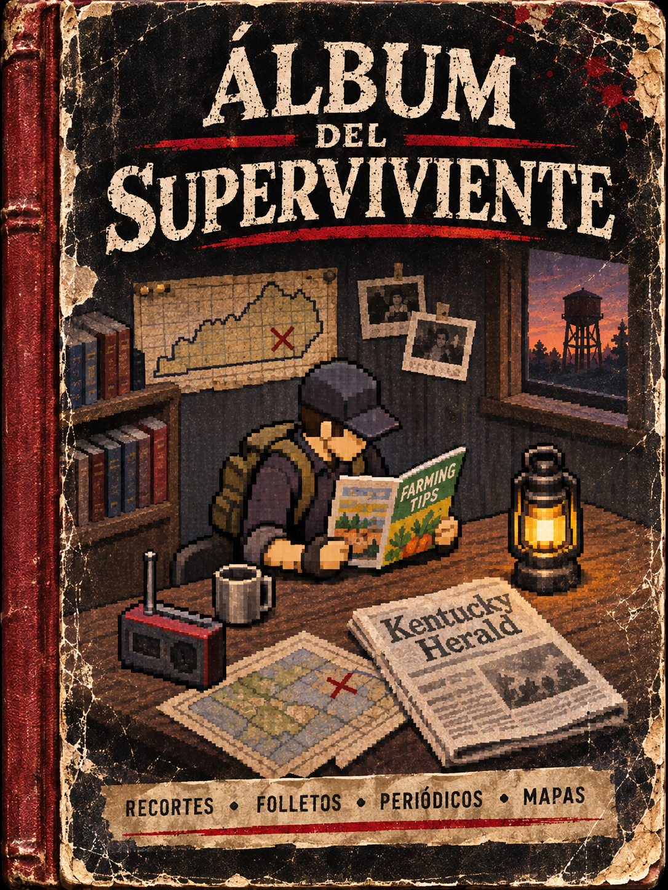
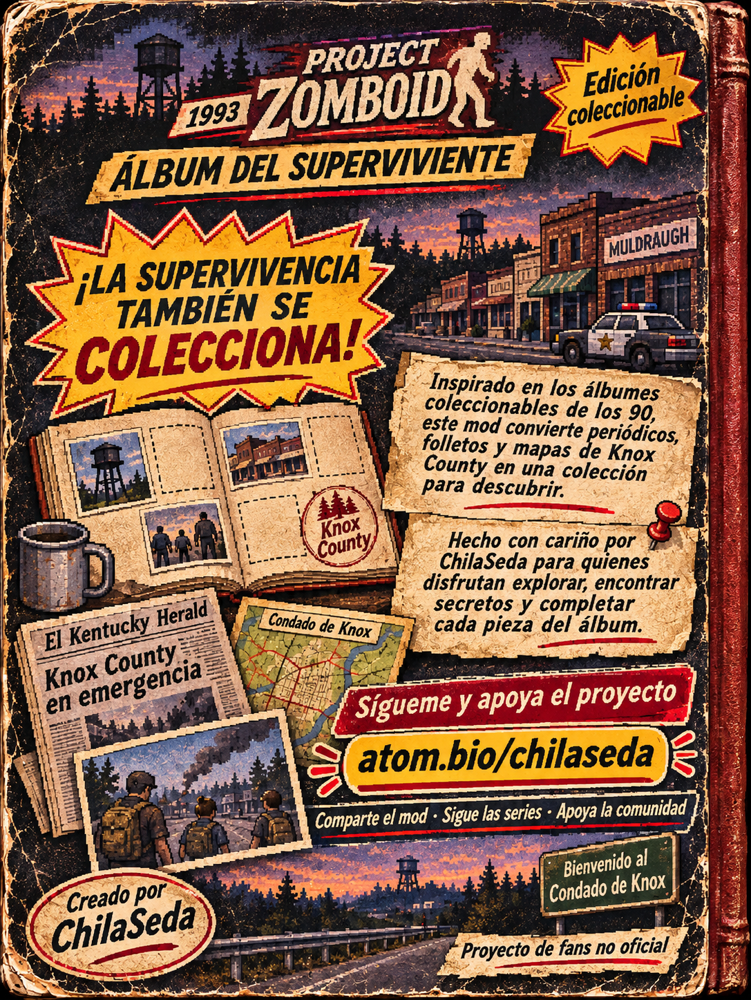

# ChilaSeda: parches y mods para Project Zomboid

Workspace de mods locales para Build 42: parches propios, herramientas de apoyo y documentación para reproducir y revisar cambios. Los directorios `ChilaSeda_*` contienen mods; `docs/` reúne manuales, bitácoras y materiales de referencia. Los mods originales de Workshop se mantienen intactos.

## Creación propia y auditoría

El **Álbum del Superviviente** es una creación de ChilaSeda, desarrollada a partir de nuestra auditoría del contenido y la experiencia de juego. El diseño, los textos y los recursos propios de este mod no deben plagiarse, copiarse ni redistribuirse como si fueran trabajo de otra persona. Para proponer mejoras, usa una rama y un Pull Request con atribución clara.

### Portada

### Contraportada

## Kit de partida Zombicidio Jill

Dejamos una carpeta con el paquete y los archivos de referencia para montar una partida nueva parecida a Jill: [`kits/Zombicidio_Jill_B42/README.md`](kits/Zombicidio_Jill_B42/README.md). Incluye el [RAR con los mods locales y el preset](kits/Zombicidio_Jill_B42/Kit_Zombicidio_Jill_B42.rar), [`mods.txt`](kits/Zombicidio_Jill_B42/mods.txt), [`map_ver.bin`](kits/Zombicidio_Jill_B42/map_ver.bin), [`Zombicidio.cfg`](kits/Zombicidio_Jill_B42/Sandbox%20Presets/Zombicidio.cfg) y la [descripción de la colección e instalación](kits/Zombicidio_Jill_B42/Descripcion_Coleccion_Zombicidio.txt). La guía explica cuándo copiar `mods.txt` y `map_ver.bin` al guardado recién creado.

Los mods de terceros, incluida la apariencia RE:3 Jill y Project Viewpoint, se descargan desde sus fuentes; el kit no los redistribuye.

## Notas comunitarias con evidencia

La comunidad puede proponer notas de errores o mejoras con capturas en [`docs/incidentes/`](docs/incidentes/README.md). Envíalas en una rama mediante Pull Request; incluimos una [plantilla de nota](docs/incidentes/PLANTILLA_NOTA.md). Revisaremos los pasos, versiones y evidencia antes de incorporarlas.

## Contribuir

Las contribuciones requieren una rama propia y un Pull Request hacia `main`. No se aceptan cambios directos en `main`; Chila revisa y autoriza antes de integrar. Consulta `CONTRIBUTING.md`.

1. Trabaja dentro del mod local relacionado y documenta cada cambio en su `README.md` o `LEEME.txt`.
2. No incluyas saves, logs de usuario, backups, credenciales, cachés ni archivos temporales.
3. Antes de proponer un cambio, indica el mod y la versión de Project Zomboid con la que lo revisaste.

Las skills e hooks compartibles están en `.agents/` y `.codex/`. `.claude/` y `.codemie/` conservan espacios de configuración portables; los ajustes locales y entornos generados se excluyen del repositorio.

## Contenido

- `ChilaSeda_*`: mods locales y parches.
- `docs/`: manuales, bitácoras, notas técnicas y material de referencia.
- `tools/`: utilidades de mantenimiento.
- `tests/`: pruebas automatizadas existentes de los mods.

