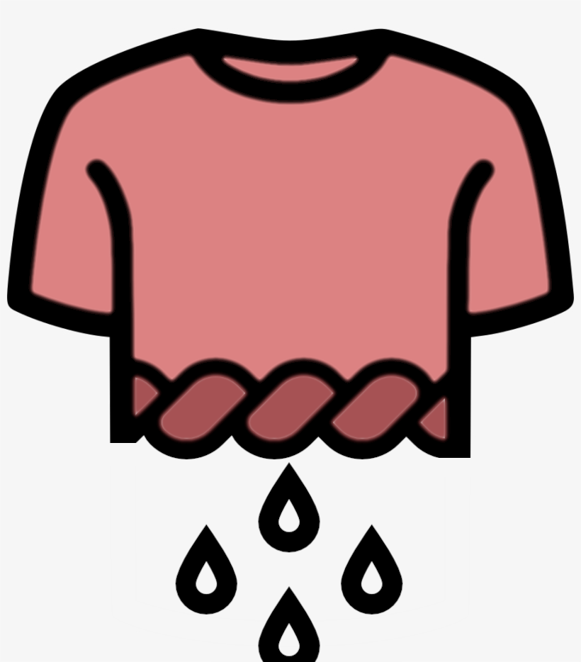
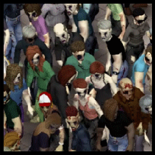



# ⏸️ Mods en pausa · partida Jill

**Colección Zombicidio · Jill · Project Zomboid Vanilla B42.22.2**

<a href="https://steamcommunity.com/sharedfiles/filedetails/?id=3812814868">🧰 Abrir colección</a> ·
<a href="README.md">🧟 Volver al kit</a> ·
<a href="https://www.atom.bio/chilaseda">📺 Canales</a>

---

> 🧭 **Estos mods siguen suscritos, pero no se cargan en Jill por decision temporal, compatibilidad o una prueba pendiente.** La pausa aplica
> Jill tiene 12 mods activos que no se agregaron a la coleccion; conservamos esta pagina para revisar compatibilidad, decisiones temporales y recuperaciones.

<table>
<tr>
<td align="center"><strong>📦 186</strong> elementos en la colección</td>
<td align="center"><strong>✅ 198</strong> con algún ID activo en Jill</td>
<td align="center"><strong>⏸️ 20</strong> suscritos y en pausa</td>
<td align="center"><strong>🧩 12</strong> mods activos faltantes</td>
</tr>
</table>

## 🧭 Índice

- [🔎 Pausados con parche o nota](#pausados-con-parche-o-nota)
- [🧭 Viewpoint Nightly RC4 y OldPoint](#viewpoint-nightly-rc4-y-oldpoint)
- [💡 Sugerencias reportadas](#sugerencias-viewpoint)
- [🌱 Recomendados para evaluar](#recomendados-para-evaluar)
- [🧪 Candidatos a ports locales Build 42](#candidatos-a-ports-locales-build-42)
- [✅ Activado en Jill por solicitud](#activado-en-jill-por-solicitud)
- [🖼️ Mods en pausa](#mods-en-pausa)
- [🧰 Cómo interpretar la pausa](#como-interpretar-la-pausa)
- [📚 Referencias](#referencias)

---

## 💡 Sugerencias reportadas como compatibles con Stable 42.22

Esta lista reúne los addons que Chila compartió como reportados por usuarios para Stable 42.22 y que no estaban activos ni en pausa en el perfil Jill al hacer el cruce. Son sugerencias pendientes de suscripción y revisión; no se han probado en esta partida. Los nombres sin enlace conservan el título recibido y necesitan confirmar su Workshop ID antes de agregarse.

- Project Viewpoint - 3D Tracer Fix
- ZCrisis Wall Clip
- Wall Vines 3D (Viewpoint)
- [Viewpoint Workstations Overhaul · Workshop 3828755546](https://steamcommunity.com/sharedfiles/filedetails/?id=3828755546)
- Viewpoint Tension
- [Viewpoint Placement Fix · Workshop 3816521966](https://steamcommunity.com/sharedfiles/filedetails/?id=3816521966)
- [Viewpoint Immersive Map · Workshop 3815544725](https://steamcommunity.com/sharedfiles/filedetails/?id=3815544725)
- [Viewpoint Wind Sway + Falling Leaves · Workshop 3823558761](https://steamcommunity.com/sharedfiles/filedetails/?id=3823558761)
- Viewpoint Camera Expansion + Camcorders
- Viewpoint - Equipment Overlays
- Viewpoint - Helicopter Fix
- Viewpoint - Proper Roofs
- Railings 3D (Viewpoint)
- Project Viewpoint - Visible Helicopter Events
- Project Viewpoint - Vanilla Steering
- Project Viewpoint - Solid Horses
- Project Viewpoint - Drive By Shooting
- Project Reflections (el reporte indica dependencia de 6282 Texture mod)
- Plane Crash Event + For Viewpoint
- Immersive Driving
- Horsemod + Viewpoint 3D patch (controls)
- Fletcher: Archery Overhaul + Viewpoint Bridge (Fletcher ya está activo; el bridge no está en el perfil)
- [Project Real Limbs · Workshop 3827957976](https://steamcommunity.com/sharedfiles/filedetails/?id=3827957976)
- [Viewpoint Minimap · Workshop 3810179295](https://steamcommunity.com/sharedfiles/filedetails/?id=3810179295)
- [Viewpoint - 3D Working TVs & Radios · Workshop 3821610732](https://steamcommunity.com/sharedfiles/filedetails/?id=3821610732) (requiere Living Props, ahora activo)

ViewpointPixelReshade (Workshop 3837874009) se agrega directamente al perfil por solicitud de Chila, no a esta lista de sugerencias; queda pendiente de que Steam lo descargue tras la suscripción.

---
## 🌱 Recomendados para evaluar

Recomendaciones sugeridas por Chila para una evaluación posterior. La inclusión aquí no confirma compatibilidad ni activa el mod en Jill. La portada abre su ficha de Steam.

[**PVZ - Plants vs Zomboid 2.2 Prerelease | 3D Viewpoint**](https://steamcommunity.com/sharedfiles/filedetails/?id=3818718796) · Workshop `3818718796`. La ficha lo presenta como prerelease y requiere Super Gore, Zombie Dismemberment [B42] y Proper Ragdolls. Su `mod.info` declara `versionMin=42.0.0` y no limita `versionMax`; esto no sustituye una prueba en 42.22.

---
## 🧪 Candidatos a ports locales Build 42

Estos mods se retiraron de la colección. La propuesta es revisar su contenido y, si hace falta, portar la función a un mod local de Build 42, como se hizo con Anomalous Storm. Las portadas abren la página de Steam; el ID queda visible para identificar cada elemento.

<table>
<tr>
<td align="center" valign="top"> <a href="https://steamcommunity.com/sharedfiles/filedetails/?id=2696083206"><strong>Wring Out Clothing</strong></a> <small>Workshop 2696083206</small> <small>Mod ID: <code>wringclothes</code></small> <small>Revisar si el parche de lavado existente ya cubre su acción.</small></td>
<td align="center" valign="top"> <a href="https://steamcommunity.com/sharedfiles/filedetails/?id=3032253803"><strong>S11 PZRP Zombie skins</strong></a> <small>Workshop 3032253803</small> <small>Mod ID: <code>PZRPs11Zombies</code></small> <small>Steam no devuelve una ficha pública; el nombre y la portada salen del mod.info instalado.</small></td>
</tr>
</table>

---

## ✅ Activado en Jill por solicitud

[**Surface Fix - Project Viewpoint**](https://steamcommunity.com/sharedfiles/filedetails/?id=3814398576) · Workshop `3814398576` · Mod ID `ViewpointSurface`. Activado en el perfil Jill a solicitud de Chila, con el parche local de crash activo. La ficha del autor aún lo marca `[BROKEN]`; queda pendiente validar el arranque y las superficies en Jill.

---

## 🔎 Pausados con parche o nota

Estos dos siguen suscritos y no se usan en Jill. Chila ya los quitó de la colección pública; quedan registrados aquí para revisar compatibilidad si después quiere recuperarlos.

Isometric No More ya no está en pausa: se reintegró en Jill porque el nightly 0.1.7 RC4 probado omitía varias opciones de colocación necesarias. El anuncio del nightly avisa que la mayoría de addons estaban rotos, pero no confirma si esa falta fue una desactivación intencional. Esperaremos una publicación oficial antes de revisar de nuevo el addon; no instalar ni probar otra copia manual.

| Estado en colección | Elemento de Workshop | ID(s) de mod detectado(s) | Nota para posible recuperación |
|---|---|---|---|
| Quitado el 11 nov. | [Wring Out Clothing](https://steamcommunity.com/sharedfiles/filedetails/?id=2696083206) · `2696083206` | `wringclothes` | Candidato a port local Build 42; revisar si el parche de lavado existente ya cubre su acción. |
| Quitado el 11 nov. | [S11 PZRP Zombie skins](https://steamcommunity.com/sharedfiles/filedetails/?id=3032253803) · `3032253803` | `PZRPs11Zombies` | Steam no devuelve ficha pública; el `mod.info` instalado permite identificarlo. Candidato a port local Build 42. |
---

## 🧭 Build 42.22 activados y versiones de OldPoint

El perfil Jill activa aqui mods declarados para 42.22 y pruebas solicitadas por Chila. Los marcados como prueba tienen cambios de `versionMax` locales en la carpeta instalada de Workshop; eso habilita la carga, pero no confirma compatibilidad en runtime. La combinacion con Viewpoint Nightly RC4 tambien queda pendiente de validar.

| Estado en Jill | Mod de Workshop | Mod ID | Nota |
|---|---|---|---|
| En pausa | [OldPoint - Rotating Overhead Camera](https://steamcommunity.com/sharedfiles/filedetails/?id=3815999052) · `3815999052` | `OldPoint` | El original es para Viewpoint 0.1.6.2. El autor pide usar el ID separado de RC4 con Nightly; no activar ambas versiones. |
| Activo en el kit | [OldPoint VP Nightly RC4](https://steamcommunity.com/sharedfiles/filedetails/?id=3838013090) · `3838013090` | `OldPointVPNightlyRC4` | Ficha del autor: PZ 42.22 / Viewpoint Nightly 0.1.7-rc4. |
| Activo en el kit | [Viewpoint - Roofs (WIP)](https://steamcommunity.com/sharedfiles/filedetails/?id=3817294484) · `3817294484` | `ViewpointRoofs` | El autor indica 42.22 y nightlies 0.1.7. La ficha de OldPoint reporta flicker en aleros. El parche local de descarga de chunks queda activo junto con el mod. |
| Activo en el kit | [Project Viewpoint: KK's TREE in 3D](https://steamcommunity.com/sharedfiles/filedetails/?id=3813172420) · `3813172420` | `ProjectViewpointNearVegetation` | El autor anuncia Build 42.22. También advierte que Nightly puede crashear; se activa por el criterio de Chila y queda pendiente de prueba. |
| Activo en el kit | [Viewpoint - Crop Visibility Fix](https://steamcommunity.com/sharedfiles/filedetails/?id=3812659173) · `3812659173` | `ViewpointCropVisibility` | Ficha del autor: Build 42.22. |
| Activo en el kit | [Viewpoint Visual Fixes](https://steamcommunity.com/sharedfiles/filedetails/?id=3821308495) · `3821308495` | `ViewpointVisualFixes` | El autor indica actualización para Project Zomboid 42.22. |
| En Jill (probar en juego) | [3d Blood VFX for Viewpoint](https://steamcommunity.com/sharedfiles/filedetails/?id=3811472160) · `3811472160` | `ViewpointBloodFX` | `versionMax` ampliado de 42.21.0 a 42.22.2 en `common` y `42`. Requiere Viewpoint y ZombieBuddy. |
| En Jill (probar en juego) | [Blood FX for Viewpoint - Fixes](https://steamcommunity.com/sharedfiles/filedetails/?id=3813801053) · `3813801053` | `ViewpointBloodFXAddon` | `versionMax` ampliado de 42.21.0 a 42.22.2 en `common` y `42`; requiere Blood FX for Viewpoint. |
| En Jill (probar en juego) | [Door Fix - Project Viewpoint](https://steamcommunity.com/sharedfiles/filedetails/?id=3812151347) · `3812151347` | `ViewpointDoor` | `versionMin=42.21`; no tenia `versionMax` que bloqueara Build 42.22. |
| En Jill (probar en juego) | [Viewpoint - Immersive Effects](https://steamcommunity.com/sharedfiles/filedetails/?id=3812984535) · `3812984535` | `ViewpointImmersiveEffects` | `versionMin=42.21`; no tenia `versionMax` que bloqueara Build 42.22. |
| En Jill (probar en juego) | [Light Fix - Project Viewpoint](https://steamcommunity.com/sharedfiles/filedetails/?id=3811344119) · `3811344119` | `ViewpointLight` | `versionMin=42.21`; probar los faros con Rolling Hills porque esa combinacion no esta confirmada. |
| En Jill (probar en juego) | [Viewpoint Rolling Hills](https://steamcommunity.com/sharedfiles/filedetails/?id=3815630947) · `3815630947` | `ViewpointRollingHills` | `versionMax` ampliado de 42.21 a 42.22.2. El autor declara Build 42.21; prueba solicitada por Chila. |
| En Jill (probar en juego) | [Rolling Hills Physics Addon](https://steamcommunity.com/sharedfiles/filedetails/?id=3817555882) · `3817555882` | `RollingHillsPhysics` | `versionMax` ampliado de 42.21 a 42.22.2. Depende de Rolling Hills; no activar junto a Viewpoint Better Terrain. |
| En Jill (probar en juego) | [Wall Texture Fix for Viewpoint](https://steamcommunity.com/sharedfiles/filedetails/?id=3820609079) · `3820609079` | `WallTextureFixForViewpoint` | `versionMax` ampliado de 42.21 a 42.22.2; revisar techos y paredes junto con Surface Fix. |
| En Jill (probar en juego) | [Viewpoint Tactical](https://steamcommunity.com/sharedfiles/filedetails/?id=3819385365) · `3819385365` | `ViewpointTactical` | Alpha; `versionMax` ampliado de 42.21 a 42.22.2 en `common` y `42`. |
| En Jill (probar en juego) | [Wilderness QoL](https://steamcommunity.com/sharedfiles/filedetails/?id=3779759338) · `3779759338` | `Wilderness QoL` | La ficha declara Builds 42.20 y 42.21; `versionMax` ampliado de 42.21.999 a 42.22.2 para la prueba solicitada. |
---

### Notas de estado y recuperacion

- **Extra Map Symbols (`2701170568`)** ya esta documentado en la tabla de pausa. La ficha de Steam no registra actualizaciones desde el 27 feb. 2022; queda pausado para decidir despues si sigue teniendo utilidad.
- **Snake's Mod Pack (`2719327441`)** permanece en pausa. La ficha no se actualiza desde el 16 dic. 2024 y lo describe como un modpack para Build 41.
- **Stab Bunker - Project Viewpoint Compatibility (`3814451969`)** permanece en pausa. Requiere Stab Bunker, Project Viewpoint, 6261 3D models for Viewpoint y ZombieBuddy; es un parche de modelos, no incluye el mapa del bunker.
- **Simple UI library (`2760035814`, modulo `UIAPI`)** es una biblioteca para que otros mods creen ventanas y dialogos; la ficha no se actualiza desde marzo de 2022. No aparece como dependencia declarada por los mods Workshop instalados en Jill.
- **Better Sorting - Le Gourmet Revolution Patch (`2868734860`)** y **No Hat Drop (`2508327382`)** siguen suscritos y en pausa; Chila planea desuscribirse de ambos. No retirarlos del conteo hasta confirmar la baja en Steam.
- **Viewpoint - Interface (`3812616893`)** queda en pausa hasta revisar que partes de la interfaz siguen haciendo falta cuando Viewpoint 0.1.7 tenga una publicacion oficial en Workshop.
- **Viewpoint Fishing (`3814560827`)** sigue en pausa y suscrito. La version de Viewpoint instalada en el kit es 0.1.6.2; no desuscribir hasta confirmar que la pesca nativa de una version oficial posterior cubra sus funciones.
- **Viewpoint Rolling Hills (`3815630947`)** y **Rolling Hills Physics (`3817555882`)** tenian `versionMax` en Build 42.21; se amplio a 42.22.2 para la prueba solicitada. La ficha del autor todavia declara Build 42.21. Physics depende del terreno Rolling Hills.
- **Viewpoint Better Terrain (`3815223174`)** tiene `versionMax=42.22.2` en la copia instalada, pero Chila decidió desuscribirse. Sigue fuera de Jill y no se combina con Rolling Hills.
- **Surface Fix (`3814398576`)** está activado en Jill a solicitud de Chila junto con el parche local que aborda el crash. El autor todavía lo marca `[BROKEN]`; falta validar el arranque y las superficies.
- **Wring Out Clothing (`2696083206`)** y **S11 PZRP Zombie skins (`3032253803`)** tienen una sección propia de ports locales arriba. Las portadas provienen de los `poster.png` instalados; el segundo no devuelve una ficha pública de Steam.

---
## 🖼️ Mods en pausa

**20 mods más** siguen suscritos y en pausa para Jill. Cada portada abre la ficha de Workshop.

Tres fixes marcados [OBSOLETE] se excluyen de esta página; Chila planea desuscribirlos. Hasta que lo haga, siguen incluidos en el conteo de suscripciones en pausa.
Los últimos tres que quedaban en la colección —**Viewpoint Better Terrain** (`3815223174`),
**Viewpoint Binoculars** (`3818585720`) y **Viewpoint Rolling Hills** (`3815630947`)— ya fueron
quitados. La verificación actual confirma que los 20 mods en pausa están fuera de la colección; Jill tiene otros 12 mods activos que no están en la colección.

El elemento **Carry Visible Items In Hands** (`3749026793`) sí coincide con `CVI` activo en Jill, por eso no aparece como candidato.

<table>
<tr><td align="center" valign="top"> <a href="https://steamcommunity.com/sharedfiles/filedetails/?id=3390655115"><strong>[COS] LALA</strong></a> <small>Workshop 3390655115</small> <small><code>[COS]LALA</code></small></td><td align="center" valign="top"> <a href="https://steamcommunity.com/sharedfiles/filedetails/?id=2779946812"><strong>Anomalous Storm</strong></a> <small>Workshop 2779946812</small> <small><code>Anomalous Storm</code></small> <small><a href="../../ChilaSeda_AnomalousStorm_B42/README.md">Port local Build 42</a></small></td><td align="center" valign="top"> <a href="https://steamcommunity.com/sharedfiles/filedetails/?id=2868734860"><strong>Better Sorting - Le Gourmet Revolution Patch (Deprecated)</strong></a> <small>Workshop 2868734860</small> <small><code>BSLGR</code></small></td></tr>
<tr><td align="center" valign="top"> <a href="https://steamcommunity.com/sharedfiles/filedetails/?id=2701170568"><strong>Extra Map Symbols</strong></a> <small>Workshop 2701170568</small> <small><code>ExtraMapSymbols, ExtraMapSymbolsUI</code></small></td></tr>
<tr><td align="center" valign="top"> <a href="https://steamcommunity.com/sharedfiles/filedetails/?id=2508327382"><strong>No Hat Drop</strong></a> <small>Workshop 2508327382</small> <small><code>NHD</code></small></td><td align="center" valign="top"> <a href="https://steamcommunity.com/sharedfiles/filedetails/?id=3815999052"><strong>OldPoint - Rotating Overhead Camera [B42 / Viewpoint]</strong></a> <small>Workshop 3815999052</small> <small><code>OldPoint</code></small></td></tr>
<tr><td align="center" valign="top"> <a href="https://steamcommunity.com/sharedfiles/filedetails/?id=3813908957"><strong>Project Viewpoint: True Weathers &amp; Lighting</strong></a> <small>Workshop 3813908957</small> <small><code>ViewpointTrueWeathers, ViewpointTrueWeathersGameplay</code></small></td><td align="center" valign="top"> <a href="https://steamcommunity.com/sharedfiles/filedetails/?id=3818718796"><strong>PVZ- Plants vs Zomboid 2.2 Prerelease | 3D Viewpoint (by Mr.DOCS)</strong></a> <small>Workshop 3818718796</small> <small><code>PvZGarden</code></small></td></tr>
<tr><td align="center" valign="top"> <a href="https://steamcommunity.com/sharedfiles/filedetails/?id=2760035814"><strong>Simple UI library</strong></a> <small>Workshop 2760035814</small> <small><code>UIAPI</code></small></td><td align="center" valign="top"> <a href="https://steamcommunity.com/sharedfiles/filedetails/?id=2719327441"><strong>Snake&#39;s Mod Pack</strong></a> <small>Workshop 2719327441</small> <small><code>AliceSPack, AmmoMaker, Barco Abandonado, BatesMetalicosRevived, BeerCapsRewardMachine, CustomMapBridge, Factory, FuelTanksMod, LeGourmetRevolution, LootZetaEnhancedEdition, MilitaryComplex, NumarkComplex, RPropaneTank, Riverside Gunstore, SkillsMag, SnakeUtilsPack, SnakeClothingMod, SnakeMansion, TableSaw, TallerMecanico, WPA, ZombiesAtWorkEvo41</code></small></td><td align="center" valign="top"> <a href="https://steamcommunity.com/sharedfiles/filedetails/?id=3814451969"><strong>Stab Bunker - Project Viewpoint Compatibility</strong></a> <small>Workshop 3814451969</small> <small><code>StabBunker-ViewpointCompatibility</code></small></td></tr>
<tr><td align="center" valign="top"> <a href="https://steamcommunity.com/sharedfiles/filedetails/?id=3820158673"><strong>Viewpoint - 3D RVs [B42.21] [WIP]</strong></a> <small>Workshop 3820158673</small> <small><code>DaleChieftainRV, DeadWorksDaleRV, DeadWorksNomadRV, GridRV, GridRVHost</code></small></td></tr>
<tr><td align="center" valign="top"> <a href="https://steamcommunity.com/sharedfiles/filedetails/?id=3812616893"><strong>Viewpoint - Interface</strong></a> <small>Workshop 3812616893</small> <small><code>ViewpointUI</code></small></td><td align="center" valign="top"> <a href="https://steamcommunity.com/sharedfiles/filedetails/?id=3815223174"><strong>Viewpoint Better Terrain</strong></a> <small>Workshop 3815223174</small> <small><code>ViewpointBetterTerrain</code></small></td></tr>
<tr><td align="center" valign="top"> <a href="https://steamcommunity.com/sharedfiles/filedetails/?id=3814560827"><strong>Viewpoint Fishing</strong></a> <small>Workshop 3814560827</small> <small><code>FishingView</code></small></td></tr>

</table>

---

## 🧰 Cómo interpretar la pausa

La pausa indica que el perfil Jill no carga el mod por compatibilidad, decision temporal o prueba pendiente. La coleccion contiene 186 elementos, todos activos en Jill. Jill tiene 12 mods Workshop activos fuera de la coleccion y 20 suscripciones en pausa.
Conservamos esos IDs para revisar si alguno puede recuperarse más adelante.

## 📚 Referencias

- La comparación está hecha contra `kits/Zombicidio_Jill_B42/mods.txt`.
- La guía para preparar la partida y usar el kit está en `README.md`.
- Los mods de terceros se mantienen en Workshop; este repositorio no redistribuye sus archivos.

---

**Actualizado el 12 de noviembre de 2026 · Inventario local**

---

### 🔗 Otros enlaces de interés

- [⬅️ Inicio del kit Jill](README.md)
- [⚙️ Configuraciones del kit](configs/README.md)
- [🏠 Inicio del repositorio](../../README.md)
- [🤝 Cómo contribuir](../../CONTRIBUTING.md)
- [🚀 Releases de mods](../../docs/releases/README.md)
